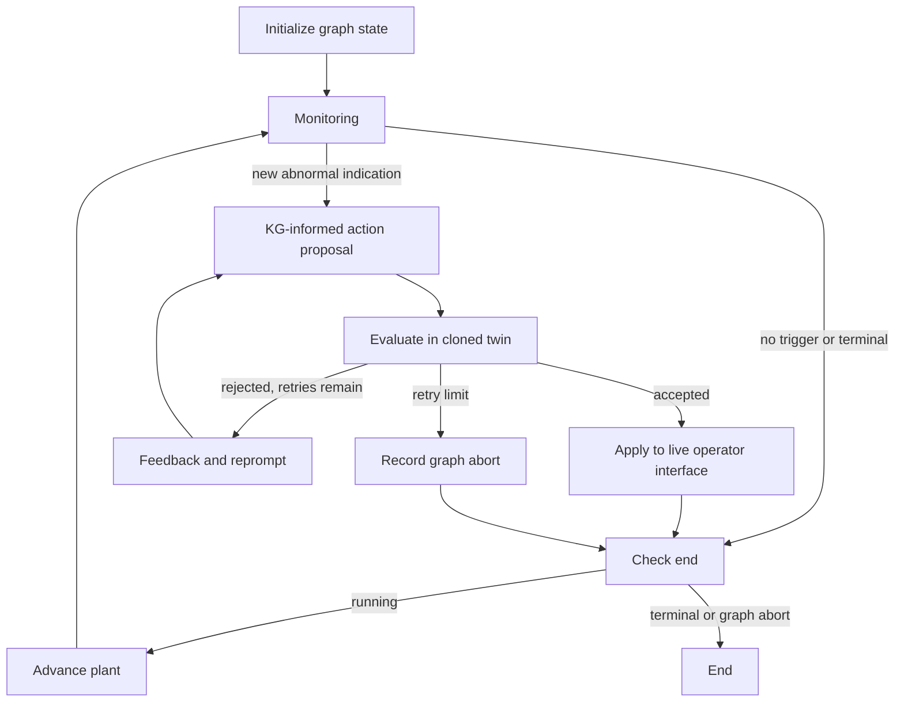

# Adaptation of your JPC case study

The source framework is
`C:\Users\jv624\Desktop\ctrl-alt-recover\case_studies\cstr_case\cstr_case.py`.
That file already uses LangGraph. The new implementation adapts its recovery
architecture to the integrated acetone CSTR/distillation simulator in this folder:

- `jpc_recovery_langgraph.py`: monitoring, proposal, cloned-twin rollout,
  evaluation, feedback, retry and accepted-action application.
- `run_jpc_recovery.py`: command-line runner and JSONL trace/plant CSV output.
- `test_jpc_recovery.py`: isolation, acceptance/rejection and graph-routing tests.

The earlier `jpc_langgraph.py` remains a simple comparison baseline and provides
the shared local KG reader and operator-action validator.

## Run the adapted framework

In PowerShell:

```powershell
cd C:\Users\jv624\Desktop\acetone_reaction

# First-time setup, or if .venv is missing
py -3.13 -m venv .venv
.\.venv\Scripts\python.exe -m pip install -r requirements-langgraph.txt

# Short offline check: pump fault at t=0, cloned-twin validation, then apply
.\.venv\Scripts\python.exe run_jpc_recovery.py --mode curated --scenario reflux_pump_trip --duration-min 3 --onset-min 0

# Full default episode, fault at 30 minutes
.\.venv\Scripts\python.exe run_jpc_recovery.py --mode curated --scenario reflux_pump_trip

# Passive simulator baseline for comparison
.\.venv\Scripts\python.exe run_v05_episode.py --mode curated --scenario reflux_pump_trip
```

If `.venv` already exists, skip the creation command. Each candidate rollout
simulates the full remaining episode at the 0.1-minute physical clock, so full
runs and multiple rejected proposals can take appreciable wall time. The live
simulation clock remains frozen while the agent proposes and the twin evaluates.

The default proposer is an offline rule smoke test. It chooses a healthy spare
for an unavailable selected pump and otherwise proposes `NO_ACTION`. It does
not implement an LLM research policy or broad abnormal-operation recovery.

For the local-LLM path, install the optional integration and use a model already
available in your running Ollama service:

```powershell
.\.venv\Scripts\python.exe -m pip install -U langchain-ollama
ollama list

# Replace MODEL_TAG with a model listed above
.\.venv\Scripts\python.exe run_jpc_recovery.py --mode curated --scenario reflux_pump_trip --ollama-model MODEL_TAG
```

The adapter uses `ChatOllama` with JSON output and a 120-second timeout.
The optional Ollama provider was not exercised against a live model here.
`make_llm_proposer(llm)` also accepts an externally configured LangChain chat
model exposing `invoke(messages)` and returning a string `content` containing
JSON. This keeps model/provider selection independent of the recovery graph.
The adapter logs call latency; provider-specific token/cost accounting from the
original case study has not been ported.

## Graph and acceptance rules



Monitoring triggers on a new abnormal indication from active alarms, failed
selected pumps, SIF latches, invalid controller outputs or high controller
demand with significant PV error. The controller-margin heuristic uses 95% of
the loop's MV range and an error above 5% of its allowed setpoint span. The
default is one accepted intervention per episode, matching the source's
`sp_change_done` gate. Library callers can set `RecoveryConfig(one_shot=False)`
to allow later rising-edge events; a continuously active event still does not
automatically retrigger. Initial monitoring happens before the first plant step
so a fault already active at time zero can be handled without an extra interval.

Before cloning, every command is validated against the existing action catalog.
The twin preserves current plant state, controllers, noise RNG, fault schedules,
SIF latches, pumps and persistent operator settings. It checks each physical
step through the remaining episode, independently of the slower decision clock.

Default rollout acceptance requires:

- No rejected commands or invalid controller outputs.
- A consecutive safe hold of one minute after a one-minute grace interval,
  achieved within ten minutes of proposal time.
- Unsafe time at most 20% of the judged time after the grace interval.
- Safe final state and no `SAFE_TRIP`, `DAMAGE`, `MODEL_LIMIT` or
  `NUMERICAL_FAILURE` terminal outcome.

Safety here means physical temperature, pressure and inventory within this
integrated model's SIF limits, no SIF latch, and no failed selected pump.
The rollout uses true physical measurements for these envelope checks; the
proposer and live monitor receive operator observations. WARNING alarms or
reduced control margin do not independently prevent a safe-hold acceptance.
This is a benchmark acceptance policy, separate from quality recovery or the
simulator's `RECOVERED` outcome. A curated fault can remain present and finish
`TIMEOUT` while the intervention passes safe-operation validation.

CLI options expose grace, hold, deadline, unsafe fraction and retry limits;
all times use minutes. `--reprompt-max 5` means one initial proposal plus at most
five retries. Evaluation feedback and the previous proposal are sent to the
proposer on each retry. Invalid JSON/provider failures are logged and stop the
run; schema/bounds failures enter the normal evaluation-feedback loop.

At the retry limit the graph ends with `reprompt_limit` without applying the
rejected candidate. The plant can still have status `RUNNING`: graph abort and
physical terminal outcome are separate fields in the trace.

## What changed from cstr_case.py

The original proposes `T_sp`, `L_sp`, `Fin_sp` for a different reactor using K,
litres and L/s. This simulator uses named regulatory loops, kmol inventories and
kmol/h throughput, and models an endothermic reaction coupled to a column.
Consequently the original 310/313 K targets, 2–11 litre envelope, grid increments,
temperature detector and exothermic load-reduction reasoning were not copied.

The adapted schema allows a validated bundle:

```json
{
  "commands": [
    {"type": "SET_SETPOINT", "target": "R_TIC", "value": 338.0},
    {"type": "SET_THROUGHPUT", "value": 85.0}
  ],
  "reasoning": "A brief justification citing supplied KG relationships."
}
```

This shows the schema, not a recommended corrective action. Always use
`env.action_catalog()` for available loop names, limits and units. Other command
types are `NO_ACTION`, `START_SPARE`, and `OPERATE_AUXILIARY`, as documented in
`RUNNING_AND_LANGGRAPH.md`. Compound commands are validated together before any
live mutation; master injection variables remain unavailable.

The source fetches Turtle with SPARQL from GraphDB. This adaptation retrieves
bounded lexical evidence from the local integrated JSON-LD KG. It is not
SPARQL reasoning or an exact reproduction of the source's query context. The
LLM receives those actual nodes and relations plus the operator catalog, and
is prompted to cite their IDs.

The source rollout clones its fault-configured twin. This adaptation likewise
uses an **oracle twin**: scheduled faults, current true physical state and RNG
state are copied into validation. Those details are not sent to the proposer,
but validation results benefit from them. Paper results should label this
assumption; a deployment-oriented twin would need independent fault/state
estimation. No checkpoint restoration or calibration of a separate twin is
implemented.

Two source behaviors were changed explicitly: ignored grace time is excluded
from the unsafe-fraction denominator, and the retry-limit fallback does not
receive an automatic pass. A rejected proposal ends the adapted run. These
changes mean the port follows the architecture rather than reproducing every
source result or acceptance decision.

Traces contain configuration, monitored observations, exact prompt context,
proposals, latency, validation trajectories, decisions, applied actions and graph
termination. Output files are `<scenario>_trace.jsonl` and `<scenario>_plant.csv`
under `jpc_recovery_results`. Repeated runs overwrite these names; use distinct
`--output-dir` values per run. Compare both validation acceptance and actual
plant outcomes; they answer different questions.

## Tests

```powershell
.\.venv\Scripts\python.exe -m unittest -v test_jpc_recovery.py test_jpc_langgraph.py
```

For running the original `cstr_case.py`, use its own repository environment and
dependencies, from its case-study directory. For example, after setup:

```powershell
cd C:\Users\jv624\Desktop\ctrl-alt-recover\case_studies\cstr_case
python cstr_case.py --fault normal --llm-model YOUR_MODEL --output .\results
python cstr_case.py --fault fouling --llm-model YOUR_MODEL --plot
```

The original selects its provider from the model name (names starting `gpt`
use its OpenAI backend, others use Ollama), loads `.env`, and optionally queries
GraphDB. It imports local twin, detector and common trace modules. Its runs
have not been executed or altered during this adaptation.

Official references:
https://docs.langchain.com/oss/python/langgraph/graph-api and
https://docs.langchain.com/oss/python/integrations/chat/ollama.
