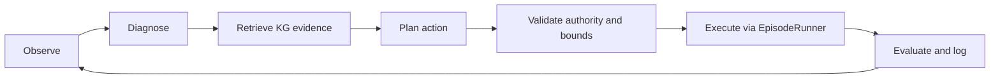

# Running the simulator and the LangGraph framework

For the adaptation based on your actual JPC framework in
`ctrl-alt-recover/case_studies/cstr_case/cstr_case.py`, see
[JPC_RECOVERY_FRAMEWORK.md](JPC_RECOVERY_FRAMEWORK.md). The workflow below is the
earlier, simpler rule baseline and remains available for comparison.

Use PowerShell in `C:\Users\jv624\Desktop\acetone_reaction`.
Python 3.13 is installed here through the `py` launcher. The bare `python`
command currently resolves to the Microsoft Store alias.

## Install and run

A local `.venv` was created while verifying the framework. If it is missing,
recreate it with `py -3.13 -m venv .venv`. Run:

```powershell
cd C:\Users\jv624\Desktop\acetone_reaction
.\.venv\Scripts\python.exe -m pip install -r requirements-langgraph.txt

# Short simulator baseline, without agent intervention
.\.venv\Scripts\python.exe run_v05_episode.py --mode nominal --duration-min 10

# Open the interactive operator console in a browser
.\.venv\Scripts\python.exe -m pip install -r requirements.txt
.\.venv\Scripts\python.exe -m bokeh serve --show operator_console.py

# Run the LangGraph baseline on a pump-trip episode
.\.venv\Scripts\python.exe run_jpc_langgraph.py --mode curated --scenario reflux_pump_trip
```

If setting up on another machine, install Python 3.11 or newer, then create
the environment with `py -m venv .venv` before the install command above.
The environment created during verification inherits this machine's existing
scientific packages; a new environment should use the requirements file.
No PowerShell activation or execution-policy changes are needed.
The simulator and LangGraph dependency file excludes optional plotting and
console packages. Bokeh was unavailable through pip during this session, so
the browser-console command remains unverified and requires its installation.

Other existing entry points:

```powershell
# A reproducible hidden-fault episode using the passive actor
.\.venv\Scripts\python.exe run_v05_episode.py --mode surprise --seed 42

# Legacy normal-operation and fault-detection data campaigns
.\.venv\Scripts\python.exe run_base_scenario.py
.\.venv\Scripts\python.exe generate_fault_detection_data.py
```

The existing episode runner saves CSV files in `episode_results` by default.
It also saves three PNG dashboards (process, actuators and safety). Add `--plot`
to display them, or `--no-plots` for CSV only. Plot an existing CSV with:

```powershell
.\.venv\Scripts\python.exe plot_v05_results.py episode_results\nominal_hold.csv --plot
```

The plots require Matplotlib; install it with
`.\.venv\Scripts\python.exe -m pip install matplotlib` if it is missing.
The LangGraph runner saves `<scenario>_decisions.jsonl` and
`<scenario>_plant.csv` in `jpc_results`. Each decision log includes observations,
diagnostic hypotheses, retrieved JSON-LD evidence, proposals, validation errors,
the action actually sent, and subsequent measurements and outcome.
Repeated runs of the same scenario overwrite these files; specify a distinct
`--output-dir` for each experiment. Physical CSV records retain the simulator's
tick-record timing; the decision log contains the returned end-of-step observation.

## Implemented workflow



`jpc_langgraph.py` compiles one decision cycle with LangGraph `StateGraph`.
`run_jpc_langgraph.py` repeats the cycle until the simulator terminates.
The simulator is frozen during diagnosis, retrieval, planning and validation;
only `env.step(action)` advances process time. Its BPCS, SIF and downstream
equipment-fault layers continue to operate as implemented in the simulator.

This is a runnable research scaffold inferred from this repository, not a
verified implementation of the JPC paper: no paper or framework diagram was
available in the project. The baseline diagnosis uses operator-visible pump
status and alarms. The baseline planner starts a healthy standby after a
selected-pump failure and otherwise takes `NO_ACTION`. It does not attempt
general fault diagnosis or pressure/temperature recovery.

KG retrieval searches actual JSON-LD nodes and returns their properties and
relations. It is bounded lexical retrieval, not embedding search, SPARQL
reasoning, or a causal inference algorithm. The baseline planner does not use
retrieved evidence to choose actions; those nodes are available to a replacement
planner. No API key or LLM is needed for the baseline.

## Replace the baseline with your paper's method

Supply diagnosis and planning functions to `build_framework`:

```python
from jpc_langgraph import LocalKnowledge, build_framework

def paper_diagnosis(observation):
    # Call your FDD model or diagnostic LLM here.
    return {"hypothesis": "...", "retrieval_terms": ["reflux", "pump"]}

def paper_planner(observation, diagnosis, knowledge):
    # Call your reasoning model here and return one structured proposal.
    return {"type": "START_SPARE", "target": "REFLUX"}

# env is an EpisodeRunner; knowledge is LocalKnowledge(path_to_jsonld).
graph = build_framework(env, knowledge,
                        diagnose=paper_diagnosis, planner=paper_planner)
while not env.done:
    result = graph.invoke({})
```

The supported proposal forms are:

```python
{"type": "NO_ACTION"}
{"type": "START_SPARE", "target": "REFLUX"}
{"type": "SET_THROUGHPUT", "value": 85.0}
{"type": "SET_SETPOINT", "target": "R_PIC", "value": 3.0}
{"type": "OPERATE_AUXILIARY", "target": "H2_BDV", "value": 1.0}
```

Use `env.action_catalog()` for current controller names and bounds. This scaffold
exposes a subset of the simulator's actions. Invalid proposals become `NO_ACTION`
and are recorded. Bounds checks enforce authority; they do not predict whether
an action will keep the process safe. Provider failures propagate and stop the
run before execution rather than being silently treated as successful decisions.

The diagnosis and planner receive copies of operator observations and retrieved
knowledge, not fault schedules, true physical states or master injection tools.
Do not include ground-truth CSV columns in their inputs during research runs.
Pump availability is explicitly provided by the existing operator observation.
No simulator restoration or checkpoint-based restart is implemented; restoring
graph state alone would not restore the mutable physical environment.

For paper experiments, retain the same scenarios, seeds and timings when
comparing the passive actor, this rule baseline, and your proposed agent.
The log's measurement changes and alarm counts are descriptive metrics, not
a validated reward or recovery criterion; terminal outcomes come from the
existing simulator evaluator.

## Verification

```powershell
.\.venv\Scripts\python.exe -m unittest -v test_jpc_langgraph.py
.\.venv\Scripts\python.exe -m unittest -v test_model.py test_v05.py test_operator_layer.py test_v053_interface.py
```

Official API reference: https://docs.langchain.com/oss/python/langgraph/graph-api
