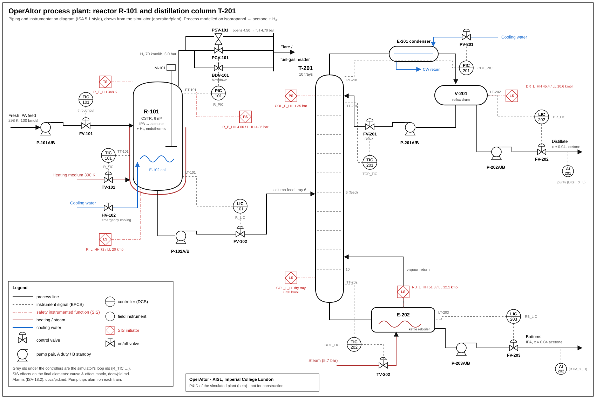

# P&ID and cause & effect

The plant as an engineer would draw it: equipment, control loops, alarms and the safety instrumented functions
(SIFs) with their cause & effect matrix. Everything here comes from the simulator (`operaitor/plant`); the tables
are generated by `python -m operaitor.plant.cause_effect` and `tests/test_cause_effect.py` fails if they no longer
match the code. The process is modelled on isopropanol → acetone + H₂ (see the
[model scope](plant-model.md#model-scope-and-known-simplifications-beta)).

## Equipment

| Tag | Equipment |
|---|---|
| R-101 | Reactor: CSTR, 6 m³, jacket heated (TV-101), agitator M-101, emergency cooling coil E-102 (HV-102) |
| T-201 | Distillation column: 10 equilibrium trays, feed on tray 6 |
| E-201 | Condenser (cooling water, PV-201) |
| V-201 | Reflux drum |
| E-202 | Kettle reboiler (steam, TV-202) |
| P-101A/B | Fresh IPA feed pumps (duty / standby) |
| P-102A/B | Reactor outlet / column feed pumps |
| P-201A/B | Reflux pumps |
| P-202A/B | Distillate pumps |
| P-203A/B | Bottoms pumps |
| PCV-101 | Reactor H₂ vent to the flare / fuel-gas header (pressure control) |
| BDV-101 | Reactor blowdown valve (SIF and operator) |
| PSV-101 | Reactor relief valve: starts to open at 4.50 bar, fully open at 4.70 bar (mechanical, no SIF) |

Every pump train alarms when its running pump fails; the operator or the agents start the standby pump. The fresh
feed (FV-101) is the throughput target set by the operator or the agents (FIC-101), not a PI loop.

## Control loops (BPCS)

| Controller | Loop id | Controls | Measured | Final element | Setpoint range |
|---|---|---|---|---|---:|
| TIC-101 | `R_TIC` | Reactor temperature, by the jacket heating | `cstr_temperature_K` | TV-101 (`cstr_heater_factor`) | 325–340 K |
| PIC-101 | `R_PIC` | Reactor pressure, by the H₂ vent | `cstr_pressure_bar` | PCV-101 (`cstr_vent_valve`) | 2.5–3.4 bar |
| LIC-101 | `R_LIC` | Reactor level, by the reactor outlet (column feed) | `cstr_holdup_kmol` | FV-102 (`cstr_outflow`) | 40–60 kmol |
| TIC-201 | `TOP_TIC` | Top-tray temperature, by the reflux | `top_temperature_K` | FV-201 (`reflux_flow`) | 325–340 K |
| PIC-201 | `COL_PIC` | Column pressure, by the condenser cooling water | `column_pressure_bar` | PV-201 (`condenser_cooling_valve`) | 0.9–1.12 bar |
| LIC-202 | `DR_LIC` | Reflux drum level, by the distillate | `drum_holdup_kmol` | FV-202 (`distillate_flow`) | 16–40 kmol |
| TIC-202 | `BOT_TIC` | Bottom temperature, by the reboiler steam | `bottom_temperature_K` | TV-202 (`steam_factor`) | 345–365 K |
| LIC-203 | `RB_LIC` | Reboiler level, by the bottoms | `reboiler_holdup_kmol` | FV-203 (`bottoms_flow`) | 18–46 kmol |

## Alarms (ISA-18.2)

Priority 1 is the most urgent. Alarms warn the operator before a SIF acts: each high-high / low-low alarm sits inside
the matching SIF limit.

| Alarm | Description | Variable | Limit | Priority |
|---|---|---|---:|:-:|
| `R_P_H` | Reactor pressure high | `cstr_pressure_bar` | ≥ 3.5 bar | 2 |
| `R_P_HH` | Reactor pressure high-high | `cstr_pressure_bar` | ≥ 3.8 bar | 1 |
| `R_T_H` | Reactor temperature high | `cstr_temperature_K` | ≥ 342 K | 2 |
| `R_T_HH` | Reactor temperature high-high | `cstr_temperature_K` | ≥ 346 K | 1 |
| `R_L_H` | Reactor level high | `cstr_holdup_kmol` | ≥ 62 kmol | 2 |
| `R_L_HH` | Reactor level high-high | `cstr_holdup_kmol` | ≥ 68 kmol | 1 |
| `R_L_L` | Reactor level low | `cstr_holdup_kmol` | ≤ 38 kmol | 2 |
| `R_L_LL` | Reactor level low-low | `cstr_holdup_kmol` | ≤ 25 kmol | 1 |
| `RB_L_HH` | Reboiler level high-high | `reboiler_holdup_kmol` | ≥ 48 kmol | 1 |
| `RB_L_LL` | Reboiler level low-low | `reboiler_holdup_kmol` | ≤ 16 kmol | 1 |
| `DR_L_HH` | Reflux drum level high-high | `drum_holdup_kmol` | ≥ 42 kmol | 1 |
| `DR_L_LL` | Reflux drum level low-low | `drum_holdup_kmol` | ≤ 14 kmol | 1 |
| `COL_P_H` | Column pressure high | `column_pressure_bar` | ≥ 1.15 bar | 2 |
| `COL_P_HH` | Column pressure high-high | `column_pressure_bar` | ≥ 1.28 bar | 1 |
| `COL_TRAY_L` | Column tray liquid low (dry-tray risk) | `column_min_tray_holdup_kmol` | ≤ 1 kmol | 1 |
| `DIST_X_L` | Distillate acetone purity low | `distillate_x_acetone` | ≤ 0.9 mol frac | 3 |
| `BTM_X_H` | Bottoms acetone high | `bottoms_x_acetone` | ≥ 0.08 mol frac | 3 |
| `P101_TRIP` | Fresh-feed duty pump trip / no selected pump flow | `pump_FEED_failed` | trip | 1 |
| `P102_TRIP` | CSTR outlet / column-feed duty pump trip | `pump_CSTR_OUTLET_failed` | trip | 1 |
| `P201_TRIP` | Reflux duty pump trip | `pump_REFLUX_failed` | trip | 1 |
| `P202_TRIP` | Distillate duty pump trip | `pump_DISTILLATE_failed` | trip | 1 |
| `P203_TRIP` | Bottoms duty pump trip | `pump_BOTTOMS_failed` | trip | 1 |

## Safety instrumented functions: cause & effect

Each SIF reads the process independently of the BPCS, latches when its limit is crossed, and overrides the commands
to the final elements below (a final element that has failed can still defeat the override). A latched SIF resets
only on request (operator, agents, or the shift operator in the benchmark) once its variable is back past the reset
value. **LATCH**: the SIF also latches the plant trip, which stops the episode as a safe trip.

Final elements:

| Column | On the P&ID | Simulator input |
|---|---|---|
| Fresh feed | P-101A/B, FV-101 | `fresh_ipa_feed` |
| Reactor heating | TV-101 (jacket steam) | `cstr_heater_factor` |
| Emergency cooling | HV-102 (E-102 cooling water) | `cstr_emergency_cooling_factor` |
| H₂ vent | PCV-101 | `cstr_vent_valve` |
| Blowdown | BDV-101 | `cstr_bdv_valve` |
| Reactor outlet / column feed | P-102A/B, FV-102 | `cstr_outflow` |
| Reflux | P-201A/B, FV-201 | `reflux_flow` |
| Distillate | P-202A/B, FV-202 | `distillate_flow` |
| Bottoms | P-203A/B, FV-203 | `bottoms_flow` |
| Reboiler steam | TV-202 | `steam_factor` |
| Condenser cooling water | PV-201 | `condenser_cooling_valve` |

STOP / CLOSE: driven to zero. OPEN: driven fully open. ≤40 %: limited to 40 % of the design value. ·: not changed.

| SIF | Cause | Trips at | Resets when | Fresh feed | Reactor heating | Emergency cooling | H₂ vent | Blowdown | Reactor outlet / column feed | Reflux | Distillate | Bottoms | Reboiler steam | Condenser cooling water | Plant trip |
|---|---|---:|---:|:-:|:-:|:-:|:-:|:-:|:-:|:-:|:-:|:-:|:-:|:-:|:-:|
| `R_T_HH` | Reactor temperature high-high | ≥ 348 K | < 345 K | · | CLOSE | OPEN | · | · | · | · | · | · | · | · | · |
| `R_P_HH` | Reactor pressure high-high | ≥ 4 bar | < 3.8 bar | · | CLOSE | · | OPEN | OPEN | · | · | · | · | · | · | · |
| `R_P_HHH` | Reactor pressure high-high-high | ≥ 4.35 bar | < 4.13 bar | ≤40 % | CLOSE | · | OPEN | OPEN | · | · | · | · | · | · | **LATCH** |
| `R_L_HH` | Reactor level high-high | ≥ 72 kmol | < 68.4 kmol | STOP | CLOSE | · | · | · | · | · | · | · | · | · | · |
| `R_L_LL` | Reactor level low-low | ≤ 20 kmol | > 21 kmol | · | CLOSE | · | · | · | STOP | · | · | · | · | · | · |
| `RB_L_HH` | Reboiler level high-high | ≥ 51.76 kmol | < 49.2 kmol | STOP | CLOSE | · | · | · | STOP | · | · | · | · | · | **LATCH** |
| `RB_L_LL` | Reboiler level low-low | ≤ 12.08 kmol | > 12.7 kmol | · | · | · | · | · | · | · | · | STOP | CLOSE | · | · |
| `DR_L_HH` | Reflux drum level high-high | ≥ 45.37 kmol | < 43.1 kmol | STOP | CLOSE | · | · | · | STOP | · | · | · | CLOSE | · | **LATCH** |
| `DR_L_LL` | Reflux drum level low-low | ≤ 10.59 kmol | > 11.1 kmol | STOP | CLOSE | · | · | · | STOP | STOP | STOP | · | CLOSE | · | **LATCH** |
| `COL_P_HH` | Column pressure high-high | ≥ 1.35 bar | < 1.28 bar | STOP | CLOSE | · | · | · | STOP | · | · | · | CLOSE | OPEN | **LATCH** |
| `COL_L_LL` | Column tray liquid low-low (dry tray) | ≤ 0.3 kmol | > 0.315 kmol | STOP | CLOSE | · | · | · | STOP | · | · | · | CLOSE | · | **LATCH** |
